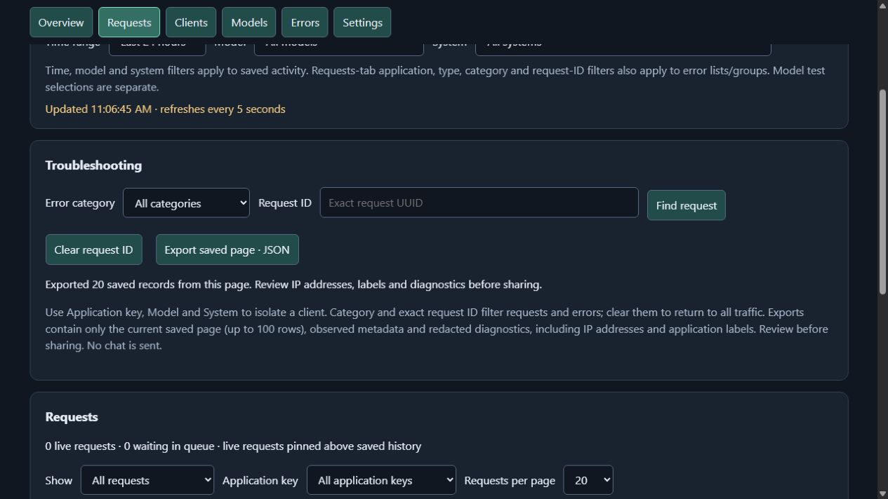
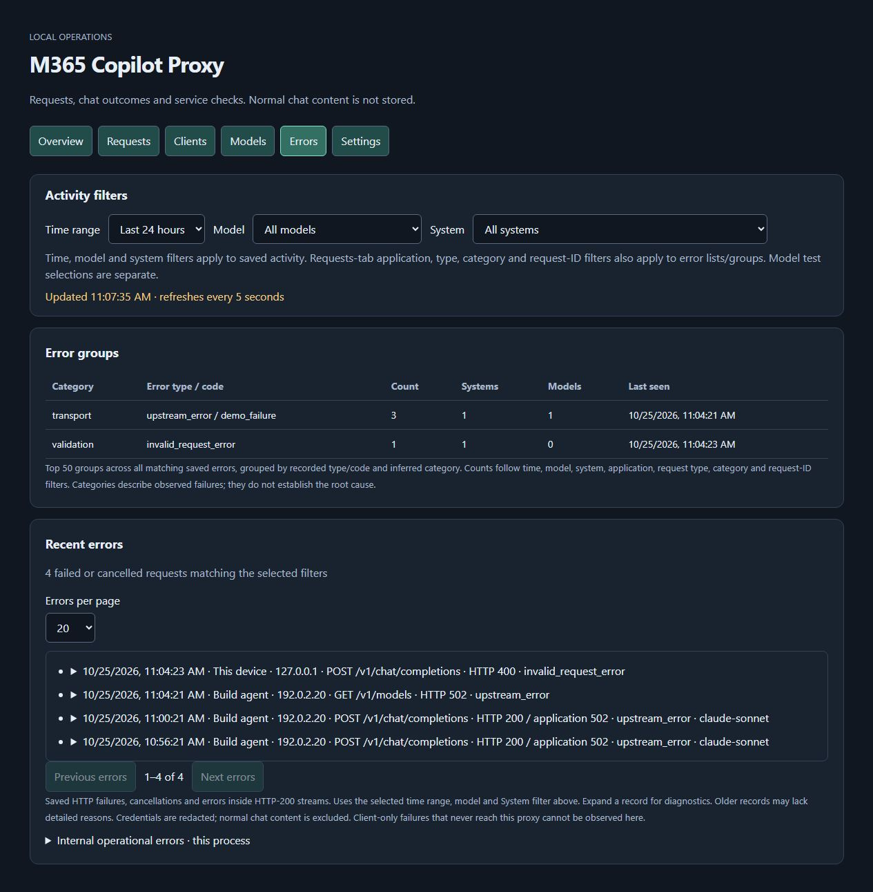

# Dashboard management and troubleshooting (0.10.0)

## Unlock management

Use **Settings → Operator access** to sign in with the administrator password
after [one-time setup](#administrator-password-0180). For initial setup or recovery,
run `.\m365-proxy.cmd operator authorize` in the portable release folder on the host
and paste the generated token in First-time setup. No development environment is
needed. The host grant expires 15 minutes after generation;
issuing a new one invalidates the previous grant. Only a SHA-256 digest and expiry
are stored in private `operator-access.json`. Treat the grant as a management
credential: it permits application-key and service changes.

Application keys never authorize management. Operator commands require an exact
same-origin POST with the separate `X-M365-Operator` header, even with keyless
application access. Application CORS allowlists do not widen this origin policy.
The browser holds the grant only in memory. Reload, Lock management or Forget key
clears it, along with any newly displayed application token. Expired grants are
rejected on every command, not merely hidden by a browser timer.

## Application keys

After unlocking, create a key with an application label, copy its token to the
client and dismiss it. A new token appears once; existing tokens and stored hashes
cannot be retrieved. Select an active key to rename it or acknowledge and revoke
it. Changes affect new requests. Historical labels remain unchanged.

Creating keys preserves the access mode. Keys remain optional by default.
Revocation in optional mode removes attribution but does not prevent keyless
access. Required/optional mode changes remain explicit local CLI commands; the
dashboard does not turn on required mode. See [application keys](api-keys.md).

## Troubleshooting and exports

Combine Requests' application key, error category and exact request UUID with the
global time/model/system filters. Error category and UUID apply to saved requests;
pending requests have no final error category. Clear the filters to restore the
full view. The Requests controls also filter Errors' list and groups. Global charts
and client totals continue to use only time/model/system filters.

Errors groups the top 50 recorded type/code combinations across all matching
history, showing frequency, distinct systems/models and last occurrence. Categories
are inferred from observed error types/statuses, not confirmed root causes. HTTP-200
SSE errors use their recorded application status. Unknown failures remain unknown.

**Export saved page · JSON** downloads the displayed saved page, up to 100 rows.
It excludes live rows, normal prompts/replies, headers, credentials and arbitrary
fields. Metadata and error diagnostics pass through an additional redaction step.
IP addresses, labels and recorded failure text are included: review before sharing.
This is a scoped page export, not a full-history export or database backup.

## Service controls

Settings inspects the current user's Windows sign-in task. Enable start at my
sign-in installs/updates that task to the current launcher; Disable sign-in startup
preserves the running process. This uses the existing Windows login and M365 state,
not a pre-login system service. Changes are explicit operator actions.

Restart pauses admission of new chats/model tests with retryable 503 responses,
then waits for admitted chats/tests. If work remains after two minutes, restart
cancels and admission resumes. Otherwise a detached helper waits for the old PID
and nonce record to disappear before starting the same launcher/data directory
under the watchdog. History flushes during normal shutdown. The dashboard reconnects.
If replacement startup fails, inspect `service-logs` and `restart-error.log` locally.

Linux supports restart through the standalone launcher; Windows sign-in task
configuration is platform-specific. Embedders have no service adapter by default.
A stopped server cannot serve its dashboard: use `m365-proxy service start` or
`m365-proxy serve` on the host. Authentication recovery still uses local
`m365-proxy login`. No action runs model tests or interactive login automatically.

## Validation

`node scripts/test-operator-runtime.mjs` tests grants, key mutations and a real
detached restart using isolated offline MSAL/WebSocket fixtures. Outbound HTTP is
disabled in the proxy and its replacement. `scripts/test-windows-service.ps1`
exercises a uniquely named temporary task and fake HTTP server. Unit tests cover
expiry, origin enforcement, drain timeout, late-response token clearing, filtered
full-history grouping and export allowlisting/redaction. No live Microsoft quota
is used. Actual sign-out/reboot and long-running soak checks remain host validation.

## Observed model reliability (0.12.0)

Models now opens with saved chat outcomes grouped by requested/served route: sample
counts, success/error/cancellation rates, mean and p95 latency, previous equal-length
period comparisons and up to 48 chart intervals. Time/model/system/application
filters apply; error-only and request UUID controls do not bias the rates. No probes
or notifications run automatically. Keys stay optional and retention unlimited.
Empty periods stay unknown, and small sample labels do not claim significance.

## Opt-in background alerts (0.13.0)

Unlock management, review Settings → Opt-in alerts and explicitly enable monitoring.
Defaults: five-minute window, ten completed chats, five errors, 50% error rate,
60-second sustain. Throttling uses the minimum volume/count without the percentage
threshold; auth-required/storage failures use the same sustain timer. Check Errors
→ Alert center for current incidents and paged events. Acknowledgement marks an
incident as seen without suppressing a later recurrence. Settings changes close
existing incidents and restart pending timers. All application keys remain optional.

Evaluation runs locally every 30 seconds while the proxy runs, independently of
browser polling and filters. No automatic model probes, auth refresh, remediation
or external notifications. A stopped/crashed proxy cannot report its own outage.
Settings/incidents/events use private alerts.sqlite with unlimited retention;
activity history backups do not include this separate state. Pending sustain timers
restart after process restart. Unknown observations do not imply recovery. If the
alert store fails, status explicitly reports monitor-unavailable.

## Notification delivery (0.17.0)

Operator access now manages named SMTP, Postal, SendGrid, ntfy and generic/Slack/Teams webhook destinations.
Saving/replacing always disables the destination and sends nothing. Preview before
explicit enablement or confirmed test. Credentials and endpoint/recipient settings
are private, stored without at-rest encryption, and never read back by the dashboard.
A separate notifications.sqlite retains the durable queue and delivery history;
activity backups do not include it. See [notification-delivery.md](notification-delivery.md) for complete setup,
lease/retry behavior, acknowledged-incident cancellation and remote acceptance limits.
No production destination or model probe is configured automatically.

## Screenshots

Synthetic data, isolated preview; no production credentials or model claims.

## Administrator password (0.18.0)

After one-time setup, sign in directly in Settings → Operator access. Set the
administrator password using a valid host grant in First-time setup, enter matching
12–256 character passwords, then sign in. Passwords are salted and hashed with
scrypt in private operator-password.json; neither plaintext passwords nor raw
session tokens are stored there. Sessions last up to 12 hours and survive proxy
restart. The page holds its session only in memory: reload requires password
sign-in, and Lock/sign out revokes that session. Nothing goes in localStorage.

Change password or explicitly Revoke all sessions to invalidate every administrator
session. Application API keys remain optional and never authorize management.
Requests require the dashboard's exact Origin; login is limited globally to five
attempts per minute with one hash operation at a time. Rate-limit counters reset
on process restart. Use a trusted network or HTTPS for management; the current
Tailnet listener's network encryption is provided by Tailscale, not HTTP itself.

First-time setup/recovery still requires host authority once. In an extracted
Windows archive containing its bundled Node runtime, open PowerShell in that folder
and run `.\m365-proxy.cmd operator authorize`. No pnpm, Nix, activation or developer
shell is needed. Installed copies have m365-proxy.cmd in the installation folder.
Paste the 15-minute grant into First-time setup, then set/reset your password.
A new host grant replaces the prior host grant but does not revoke administrator
sessions; password changes and Revoke all sessions do. Keep the private data folder.
Activity backups exclude administrator credentials and sessions.

## Per-model alert rules (0.22.0)

Settings → **Opt-in alerts → Per-model alerts** lets an administrator add up to ten
model rows. Choose exact requested model IDs from the suggestions. Aliases are
separate routes; a requested model that falls back still counts against the requested
ID, not the served model. Unknown/custom names are anonymized by existing request
logging, so choose an advertised ID rather than an arbitrary custom string.

Each row has failure/throttling switches, minimum completed chats, minimum errors
and failure percentage. Failure rules require both error count and percentage;
throttling requires the count without the percentage. The global rolling window
and sustain time apply to model rows too. **Enable background alert monitoring**
is required; global failures/throttling switches control only the all-model rules.
Saving empty model rows or duplicate IDs is rejected. Removing a row takes effect
only when Apply alert settings succeeds. Reload saved settings discards drafts.
Polling preserves edits. Existing settings default to no model rows on upgrade.

Only completed application chat requests count. SSE application errors count even
when HTTP status is 200. Explicit self-checks/model tests, unrelated endpoints and
future-dated requests are excluded. Cancellations count as traffic but not errors.
At least the row's minimum traffic is needed to open **or resolve** a model incident;
missing/low-volume observations and unavailable activity storage are unknown, so
quiet models do not falsely recover. Interrupted sustain timers restart. This uses
saved observations and never initiates a model probe or sign-in.

Overview/Errors → **Alert center** labels model-scoped incidents and events by
requested model. Each (rule, model) has an independent incident, acknowledgement
and recovery; all-model incidents can coexist. Settings changes still reset existing
incidents and sustain timers. Model notifications use existing failures/throttling
routing: enabling model rules authorizes their configured model IDs in notifications.
Fixed counts/messages and the configured ID are sent; no arbitrary error text,
prompts, answers, keys or client identifiers are included. Existing enabled destinations
may receive these future events if their routing matches. No destinations are created
or enabled by adding rules. A single condition can generate both global and model
notifications when both are configured.

The private alerts.sqlite upgrades transactionally from schema 1 to **schema 2**,
adding model scope and composite incident uniqueness while preserving incident IDs,
acknowledgements, event sequence numbers and saved configuration. New global rows
use an empty model scope. Activity schema remains 5, notification schema remains 1,
and activity backups still exclude alerts. Older binaries cannot read alert schema 2;
keep a stopped-host copy of alerts.sqlite and its sidecars before a rollback. Metrics
sum global and model incidents under existing fixed rule labels; no model labels are
added to Prometheus.

Screenshot placeholder: capture Settings → Per-model alerts with a synthetic model
row and thresholds, then Errors → Alert center showing two independently scoped
model incidents. Use fixture data; do not trigger live failures just for screenshots.
