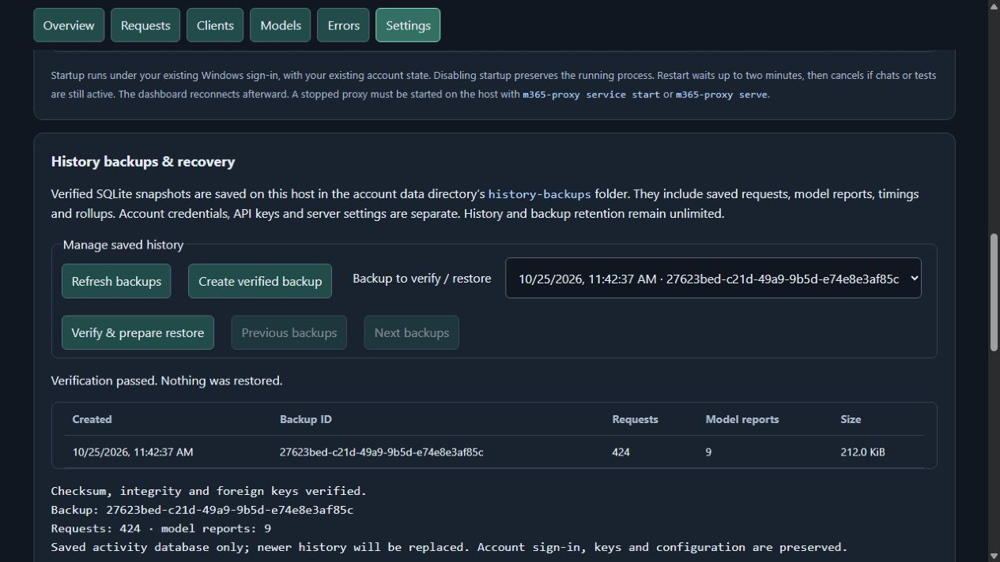
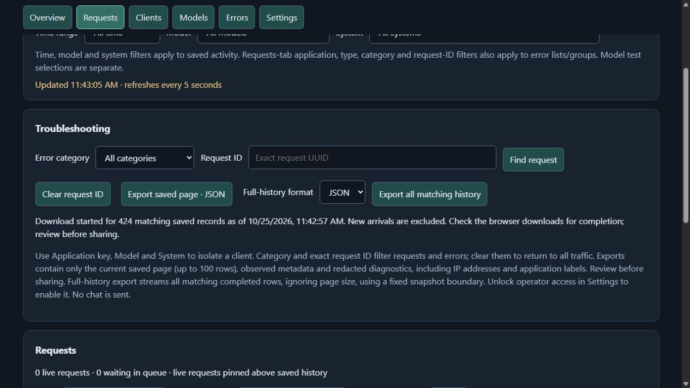

# Full-history exports and backups (0.11.0)

## Export all matching requests

Unlock **Settings → Operator access** using `m365-proxy operator authorize` on the
host, then return to Requests. Select JSON or CSV beside **Export all matching
history**. The download includes every completed saved request matching the current
time, model, system, application, type, category and exact-UUID filters. Pagination
does not limit it. The older **Export saved page** button still exports just that page.

The export captures a fixed insertion-sequence boundary and filter time when requested.
New arrivals are excluded, even with backdated timestamps. Rows stream in insertion
order through bounded 50-row database reads; the browser downloads directly to disk.
There is no giant server array, browser Blob, long read transaction or OFFSET scan.
Normal request writes continue; this is an append-only database snapshot boundary,
not a copy of the database. Live requests and undated aggregate-only legacy counts
are excluded. Model-test reports are separate from request exports; backups include them.

JSON contains snapshot/count/filter metadata and request records; CSV flattens
diagnostics and includes timelines as quoted JSON cells. CSV quotes cells and
prefixes possible spreadsheet formulas with an apostrophe. Exports include IPs,
application labels and recorded error text. Known credential forms receive another
redaction pass; arbitrary fields, headers and normal conversation content are omitted.
Review exported files before sharing; pattern redaction cannot identify every possible
secret in arbitrary error text.

The operator-authorized POST issues an unpredictable one-use download URL valid
for 60 seconds. It contains no application/operator token, but grants access to that
export until consumed or expired: keep it private. Download paths are excluded from
activity logging, have no-referrer/no-store headers and reject foreign Origins.
At most four pending/active downloads are allowed per process, and a download has
a ten-minute deadline. Reload/restart invalidates unused process-local URLs. Check
the browser download manager for completion; interrupted streams must be requested again.

## Create and verify backups

In **Settings → History backups & recovery**, unlock management, then choose
**Create verified backup**. Backups remain on the proxy host inside the existing
account data directory's `history-backups` folder. Refresh/browse the list in pages
of 20. Select a backup and **Verify & prepare restore** to check it again and show
the host commands. No restore occurs from that button.

Each backup uses SQLite's online backup API, not a copy of the live `.sqlite` file
that might omit its WAL. The dashboard flushes buffered records first. A worker
checks schema 5, integrity, foreign keys and required tables; a manifest records
SHA-256, bytes and request/report counts. Hashing streams the file. Verified files
and manifests are private and are published only after successful creation. The
list displays recorded metadata, not a fresh integrity check on each refresh.
Incomplete/unreadable entries are reported separately.

**Alert monitoring state is separate:** alerts.sqlite (0.13.0) stores alert settings,
incidents and events. History backups/restores do not include or roll back that file.
Combined operational backup remains queued.

Backups include requests, diagnostics, timings, application attribution, model-test
reports and rollups. They do **not** include Microsoft credentials, API-key stores,
server settings or browser profiles. They contain saved operational data and should
be treated as private. Backup files are not downloadable through the dashboard yet;
copy them from the host if you need off-host disaster recovery, preserving the
matching `.json` manifest. SHA-256 detects corruption, not a malicious replacement
of both files; use trusted storage.

Local CLI equivalents:

```sh
m365-proxy history backup
m365-proxy history list
m365-proxy history verify <backup-id>
```

CLI online backup captures committed database rows; recent process-buffered records
may not yet have flushed. No scheduled backup, model request, retention limit or
automatic deletion is enabled. Requests **and backups** retain data indefinitely.
Monitor disk use and keep sufficient free space for snapshots and a restore stage.
Very large databases may exceed the current 30-second verification-worker deadline.

## Restore deliberately, while stopped

Restoring replaces history, including newer records. Preview first; only apply the
selected backup after reviewing the counts and confirming its exact ID:

```sh
m365-proxy stop
m365-proxy history restore <backup-id>
m365-proxy history restore <backup-id> --apply --confirm <backup-id>
m365-proxy serve
```

Preview verifies checksum/integrity without replacing anything. Apply refuses a
recorded running instance, acquires maintenance/backup locks, stages and rechecks
the selected database, then creates a verified safety backup of the current history.
It checkpoints the current WAL before replacing the database. Account sign-in,
application keys and settings are preserved. Use the returned safety-backup ID to
restore the newer history if needed. Stop all other programs accessing this database
as well; this interlock manages this proxy's CLI instance, not arbitrary external tools.

Startup refuses a history-maintenance lock. If a process or machine crashes during
restore, preserve the lock/staged/current files and inspect the verified safety
backup before recovering; do not simply remove the lock and start serving. A stale
instance record also blocks restore until inspected. A corrupt or busy current
database is refused so uncheckpointed data is not silently discarded: preserve the
original database and its WAL/SHM files for offline investigation before recovery.
This feature is history recovery, not an account-state backup or managed-version rollback.


## Screenshots

Synthetic, isolated preview. No production credentials, history or restores.




